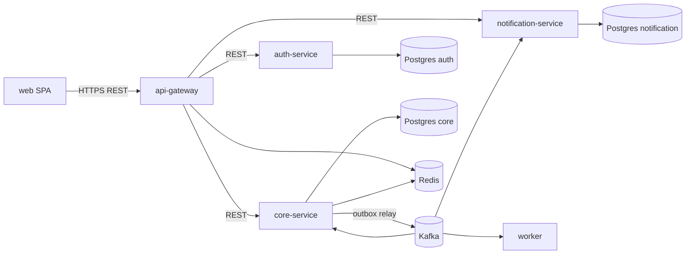
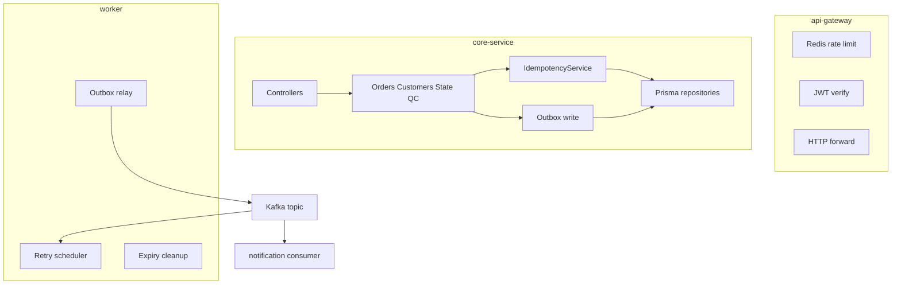
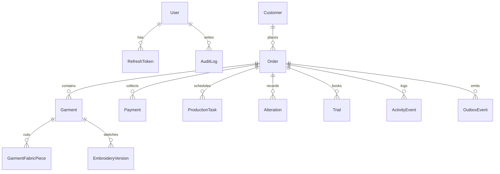
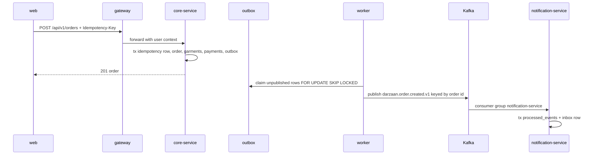

# Darzaan API architecture

Darzaan is a bespoke tailoring workspace. `web/` renders the existing `webapp/` screens without changing their forms, field keys, placeholders, options, or step order. `api/` is the system of record those screens read and write.

## High-level architecture



The browser never talks to Kafka, Postgres, or Redis. The gateway is the only public HTTP entry.

## Low-level architecture



Each NestJS process owns its module graph. Shared code lives in `libs/` and is compiled into each process. Services do not import each other's Prisma clients.

## Service responsibility matrix

| Service | Owns | Does not own |
| --- | --- | --- |
| api-gateway | TLS edge concerns, CORS, security headers, rate limit, access-token check, request id, routing | Business rows, passwords, events |
| auth-service | Users, password hashes, refresh-token families, audit log | Orders, notifications |
| core-service | Customers, orders, garments, tasks, payments, QC, trials, alterations, price requests, logistics, inventory, store floor, idempotency, outbox | Password hashes, notification inbox |
| notification-service | In-app notifications, message log, its processed-event and retry tables | Order totals |
| worker | Outbox publish, retry topic timing, retention cleanup, DLQ depth log | Request validation |

Synchronous calls are used when the user is waiting: login, create order, load the workspace. Kafka is used after the row is committed: notify, project read models, and recover from a failed consumer.

## Database

One Postgres instance, three databases (`darzaan_auth`, `darzaan_core`, `darzaan_notification`). A service migrates only its own database.



`Order.document` and `Customer.document` store the exact object the screens already use. The columns next to them (`status`, `store`, `deliveryDate`, `stage`, payment amount, and so on) are there so filters, indexes, and foreign keys are real. Child rows are rewritten in the same transaction as the document.

Soft delete is only on `Customer` and `Order`. Cancelled orders stay queryable. Other rows are removed when the parent document no longer contains them.

Hot indexes:

- `orders (store, status, delivery_date)`
- `garments (stage, assignee)`
- `activity_events (order_id, at)`
- `idempotency_keys (scope, key)` unique
- `processed_events (consumer, event_id)` primary key

## API contracts

Base path: `/api/v1`. Errors:

```json
{ "error": { "code": "VALIDATION_ERROR", "message": "…", "details": [], "requestId": "…" } }
```

| Method | Path | Auth | Notes |
| --- | --- | --- | --- |
| POST | `/auth/login` | Public | `{ email, password }` → access token (15 min) and refresh token |
| POST | `/auth/refresh` | Public | Rotates the refresh token. Reuse revokes the family |
| POST | `/auth/logout` | Bearer | Revokes the presented refresh token |
| GET | `/auth/me` | Bearer | Signed-in user and role |
| GET | `/state` | Bearer | Workspace shaped like the screens. Prices, payments, and contacts are removed when the role's data scope says so |
| POST | `/state/import` | Bearer, non-production or admin | Loads the reference seed once |
| POST | `/orders` | `order:create` | Header `Idempotency-Key`. Body is the order object the form already builds |
| PATCH | `/orders/:id` | role permission used by that action | Same order object. Protected money fields are merged back for workshop roles |
| POST | `/customers` | `customer:create` | Customer object |
| PATCH | `/customers/:id` | `customer:update` | Customer object |
| PUT | `/collections/:key` | Bearer | Phase B lists: packages, movements, deliveries, floor drafts, inventory, catalog, team |
| GET | `/production/board` | Bearer | Garments grouped by `stage` |
| GET | `/dashboard/kpis` | Bearer | Cached in Redis for 30 seconds |
| POST | `/qc/inspections` | Bearer | Inspection record, idempotent |
| GET | `/notifications` | Bearer | Inbox for the caller's role |
| POST | `/notifications` | Bearer | Exact alert the screen already built |
| POST | `/notifications/:id/read` | Bearer | |
| POST | `/notifications/read-all` | Bearer | |
| POST | `/public/bookings` | Public | Storefront consultation. Creates the customer and floor draft |
| GET | `/public/orders/:id` | Public | Tracker payload: order plus customer name |
| GET | `/public/slots` | Public | Open marketing consultation times for `date` and `mode` |
| POST | `/public/appointments` | Public | Marketing appointment request. One active booking per date, time, and mode |
| POST | `/public/franchise` | Public | Marketing franchise enquiry |
| GET | `/consultations/appointments` | Admin | Website appointment requests, newest first |
| GET | `/consultations/franchise` | Admin | Website franchise enquiries |
| GET | `/consultations/slots` | Admin | Day board for both consultation modes. Query `date` |
| PATCH | `/consultations/appointments/:reference` | Admin | `{ status }` of requested, confirmed, cancelled, or completed. Cancelling frees the time |
| GET | `/health/live` | Public | Process is up |
| GET | `/health/ready` | Public | Database, and Redis or Kafka when configured |

Swagger is served at `/docs` on each process.

## Event flow



Topic name: `darzaan.<aggregate>.<event>.v<version>`. The message key is the aggregate id, so one order stays in order on a partition.

Envelope:

```json
{
  "eventId": "uuid",
  "type": "order.created",
  "version": 1,
  "occurredAt": "2026-11-03T10:00:00.000Z",
  "correlationId": "request id",
  "causationId": null,
  "aggregateId": "DZ-10293",
  "payload": {}
}
```

Event types: `order.created`, `order.confirmed`, `order.cancelled`, `payment.recorded`, `price_request.created`, `price_request.answered`, `garment.stage_changed`, `qc.failed`, `qc.passed`, `trial.booked`, `alteration.opened`.

## Transactions

A request that changes an order runs in one Prisma transaction:

1. Insert or lock the idempotency row.
2. Merge fields the caller's data scope is not allowed to overwrite.
3. Upsert the order, replace its child rows, and append activity.
4. Insert outbox rows for the diff against the previous document.
5. Store the HTTP response on the idempotency row and mark it `COMPLETED`.

The Kafka publish happens after commit, in the worker. If the process dies between commit and publish, the outbox row is still unpublished and the next poll sends it.

There is no distributed transaction. The notification inbox is updated by the consumer. If that consumer is down, the order is still saved and the outbox keeps the event.

## Idempotency

Header: `Idempotency-Key`. Scope examples: `order.write`, `customer.write`, `qc.inspection`.

| Stored status | Same body | Different body |
| --- | --- | --- |
| COMPLETED | Replay the stored response | 422 |
| IN_PROGRESS and lock is fresh | 409 | 409 |
| FAILED, or lock is older than 30 seconds | Run again | Run again |

Keys expire after 24 hours. The worker deletes expired keys and processed-event rows older than 30 days. The unique key is `(scope, key)`.

Consumers insert `(consumer, eventId)` in the same transaction as the inbox write. A redelivery hits the unique key and commits without a second write.

## Retry and failure recovery

KafkaJS producer uses `acks: -1` and `idempotent: true`. A failed consumer does not commit the offset until the failure is recorded.

| Attempt | Delay topic | Wait |
| --- | --- | --- |
| 1 | `<topic>.retry.5s` | 5 seconds |
| 2 | `<topic>.retry.30s` | 30 seconds |
| 3 | `<topic>.retry.2m` | 2 minutes |
| 4 | `<topic>.retry.10m` | 10 minutes |
| 5 | `<topic>.dlq` | stop |

The retry worker stores `nextAttemptAt` and publishes back to the original topic when it is due. Offset commit happens after that row is stored, so a crash retries the record rather than losing it.

## Security

- Access tokens are signed JWTs, 15 minutes, checked on the gateway and again in each service.
- Refresh tokens are random, stored as SHA-256, rotated on every refresh. Presenting a revoked token revokes the whole family.
- Passwords are hashed with bcrypt (cost 12). Argon2 is the preferred algorithm; bcrypt is the implemented one because it installs cleanly on the Windows toolchain used for this repo. The hash is upgradeable per user later.
- Permissions come from the same role matrix as `webapp/src/utils/roles.ts`.
- Data scope is applied on read and on write. Workshop roles do not receive prices, payments, or customer contacts, and a write from those roles cannot blank those fields.
- Rate limit: 120 requests per minute per IP, counted in Redis.
- Helmet, CORS allow-list, validation on auth DTOs, Prisma parameterised queries.
- Secrets only from the environment. `.env.example` has placeholders.

## Performance

- Redis caches dashboard KPIs (30s) and the catalog snapshot (60s).
- List queries read the order document plus the indexed columns. Child graphs are loaded with one `include`, not a query per garment.
- Pagination on audit and notification lists uses `take` and a cursor.
- The outbox relay batches 20 rows.
- Services enable Nest shutdown hooks so Kafka consumers leave the group before exit.
- CPU-heavy work is not done on the request path. Publish and notification fan-out run on the worker and the consumer.

## Observability

- Pino JSON logs with `service`, and redaction of authorization and password fields.
- `x-request-id` is created at the gateway and copied into the event `correlationId`.
- OpenTelemetry SDK starts when `OTEL_ENABLED=true` and exports OTLP to the collector.
- `/metrics` exposes process counters from `prom-client`, plus outbox and Kafka publish counters.
- `/health/live` and `/health/ready` check Postgres and, when their URLs are set, Redis and Kafka.

## Scalability and deployment

Local: `docker compose` (see `api/README.md`) runs Redis, Kafka in KRaft mode, Kafka UI, the OpenTelemetry collector, Jaeger, and—via `docker-compose.apps.yml` plus an env override—the five Node processes. Postgres URLs come from `.env.development`, `.env.staging`, or `.env.production`, not from compose YAML.

AWS shape, not provisioned by this repo:

- ECS Fargate service per process, behind an ALB pointed only at the gateway.
- RDS Postgres, three databases, one user per database.
- ElastiCache Redis.
- Amazon MSK for the Kafka topics.
- Secrets Manager for `JWT_SECRET` and database URLs.
- Each service scales on its own CPU. The gateway and core-service are the first to add tasks. Consumers scale inside their Kafka group.

## Trade-offs

- **Document plus relational rows.** The screens round-trip a nested order. Storing that object keeps every form key. Normalised children keep constraints and indexes. The cost is rewriting children on each save. That is cheap next to a wrong form mapping.
- **Outbox instead of a dual write.** The request is slightly slower inside the transaction and events are briefly delayed. The order can no longer be saved while the event is lost.
- **Kafka instead of a broker with per-message ack.** Ordering per order is natural with the aggregate key. Retry delay is not built into the log, so a scheduler table implements it. That is more moving parts and a clearer replay story.
- **Bcrypt rather than Argon2.** Same password-hashing role, fewer native build failures on Windows. Cost can move to Argon2 without a schema change.
- **One core-service database for the tailoring workflow.** Orders, QC, and packing share a transaction when a garment changes stage. Splitting them now would invent distributed transactions the workflow does not need. Notification and auth are already separate because they have different scale and secrecy.
- **UI notifications stay the words the screens already use.** The consumer still records the event. If the screen just wrote an alert for the same order, the consumer does not add a second row.
